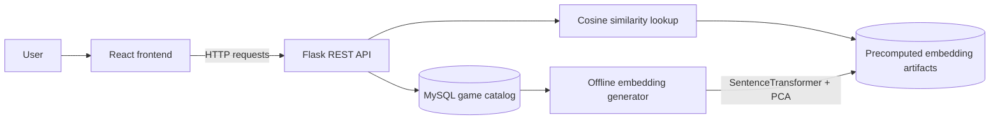

# Game Recommendation System

**A containerized, content-based game recommender built with Python, Flask, React, and MySQL.**

Originally developed as an internship project, this application lets users select games they enjoy and discover other games with similar descriptions. It combines a browser-based interface, a REST API, a relational game catalog, and precomputed text embeddings.

> **Project status:** Historical portfolio project (2022–2023). The repository documents the original implementation; the current Docker build and dependencies have not been recently revalidated. It is not presented as a production-ready service.

## Demo


In the original workflow, users choose **five games** from a displayed selection. The backend retrieves **three similar titles per selected game** and returns their catalog details for the frontend to display. Duplicate recommendations may occur.

## Architecture



The services are orchestrated with **Docker Compose**:

| Component | Technologies | Responsibility |
| --- | --- | --- |
| Frontend | React, JavaScript, Sass, Material UI | Selection interface and recommendation display |
| API | Flask, Flask-SQLAlchemy, Marshmallow, Waitress | Routes, catalog access, and recommendation responses |
| Recommendation engine | SentenceTransformers, scikit-learn, pandas, NumPy | Offline text embeddings and similarity lookup |
| Database | MySQL | Game metadata and summaries |

### Recommendation pipeline

1. The game catalog is initialized from the SQL dump in `database/`. The source filename identifies it as a Metacritic-scraped dataset; confirm its provenance and redistribution rights before reusing it elsewhere.
2. The offline generator (`backend/server/engine/engine_generator.py`) encodes game summaries with `all-mpnet-base-v2`, saves embedding arrays, and separately produces a **six-component PCA** artifact.
3. At application startup, the backend loads saved arrays and computes a cosine-similarity matrix from the **original sentence embeddings** (not the PCA-reduced vectors).
4. For each requested game title, the recommendation code selects its three nearest other rows by similarity and looks up their details in MySQL.

The PCA artifact is currently used for row-index alignment, while similarity rankings are computed from the full embeddings. This distinction matters when reviewing or extending the implementation.

## API overview

| Method | Route | Purpose |
| --- | --- | --- |
| `GET` | `/game-list` | Return a random set of twelve catalog games with scores above the configured threshold |
| `POST` | `/api/recommendations` | Accept a JSON array of selected game titles and return similar games |

Example request body (titles must exist in the loaded catalog):

```json
["Example Game Title A", "Example Game Title B"]
```

This is an **illustrative payload shape**, not a request verified against the included database.

## Running locally (historical instructions)

Requirements: Docker and Docker Compose, with local ports **3000** and **8000** available under the current Compose configuration. MySQL remains reachable to backend containers via the internal Compose network; it does not need a published host port.

```bash
git clone https://github.com/blazingfringe/Game-Recommendation-WebApp-JTP.git
cd Game-Recommendation-WebApp-JTP
docker compose up --build
```

The original setup exposes the frontend at `http://localhost:3000` and maps the backend's internal port 5000 to host port 8000. The first startup was documented as taking several minutes while the database initialized.

**Before trying to run it:** The historical configuration has known issues requiring attention. In particular, Docker Compose declares `MYSQL_DATABASE=games_db`, while the Flask configuration and embedding generator connect to `gamesdb`. Inspect the SQL dump's database creation statements and align these names. The MySQL health check now uses an authenticated TCP database query instead of an HTTP request. **End-to-end startup remains unverified**, and the database-name inconsistency may still require a fix.

The [backend documentation](./backend/Readme.md) describes regenerating embedding artifacts. Additional material is available in the [design document](./docs/Game_Recommender_Design_Document.pdf) and [frontend documentation](./docs/Readme.md).

## Design choices and limitations

- **Content-based recommendations:** Sentence embeddings capture relationships between game descriptions without requiring user behavior histories or collaborative filtering data.
- **Precomputation:** Building similarity data ahead of time makes request-time ranking straightforward, but constructing a full pairwise similarity matrix has approximately **O(n²)** memory requirements for `n` catalog entries.
- **Matching and duplicates:** Lookup depends on exact catalog titles; the existing request path does not clearly handle missing titles, validate request shape, or deduplicate overlaps across selections.
- **Local-development configuration:** The repository still contains hardcoded development database credentials. MySQL is no longer published to a host port, but this configuration is **not suitable for an internet-accessible deployment**.
- **Reproducibility and testing:** Dependencies and images are from the original project era. A GitHub Actions workflow now validates Docker Compose configuration syntax; this is **not an integration test**. Dedicated backend tests, current dependency checks, and an actual end-to-end startup test remain outstanding.
- **Artifact safety:** The repository loads a Python pickle artifact. Only load such artifacts from a source you trust.

## Possible next improvements

1. Verify the SQL dump's database creation statements, reconcile `games_db` vs `gamesdb`, and confirm clean Docker Compose startup.
2. Move the remaining hardcoded database credentials into local environment configuration.
3. Add API validation, missing-title handling, deduplication, and deterministic response tests.
4. Benchmark recommendation startup and memory use, then consider a top-*k* or vector-index approach to avoid materializing an all-pairs similarity matrix.
5. Extend CI beyond Compose syntax checks; document data/model provenance and licensing.

## Project context and reuse

This repository preserves work from an **internship project**, rather than claiming to be a currently operated production system. It is published for demonstration and technical discussion. **No repository-wide software license is currently declared**; check code, model, and dataset ownership and permissions before copying or redistributing any part of it.
